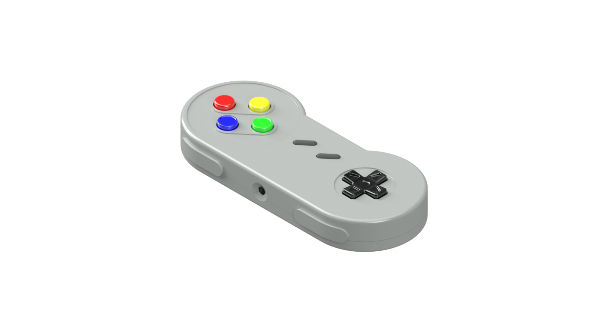
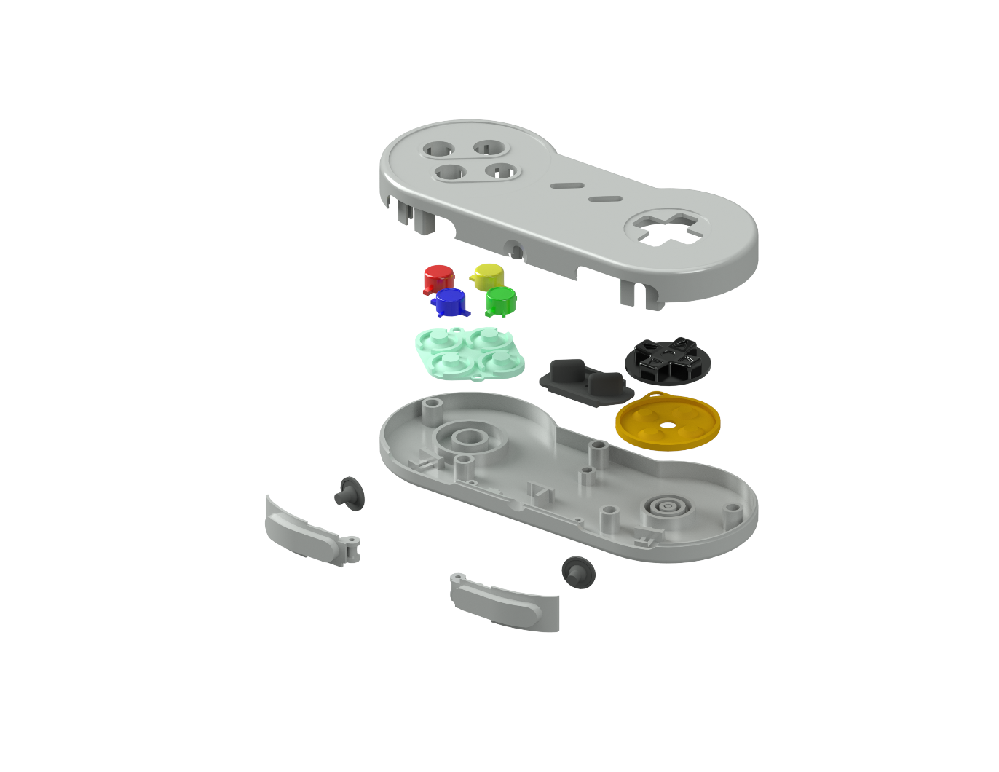
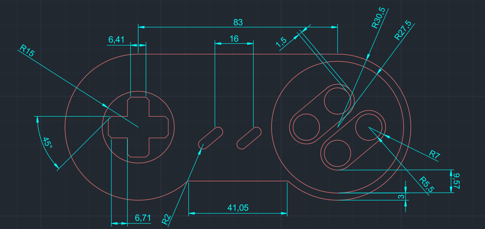

# gamepad-design-cad

A part-by-part AutoCAD reconstruction of the Super Nintendo (SNES) controller: the two-piece shell, the face buttons, the D-pad, the shoulder buttons and the rubber membranes underneath them. Every part goes from a dimensioned 2D sketch to a solid 3D model, and the parts come together in a rendered exploded assembly.

<p align="center">
  
</p>

Coursework for *Computer-Aided Graphics* at the University of Bucharest, Faculty of Mathematics and Computer Science, 2025.

## Exploded view

<p align="center">
  
</p>

From top to bottom: the upper shell, the A/B/X/Y buttons, the face-button membrane, the Start/Select membrane, the D-pad with its membrane, the lower shell, and the L/R shoulder buttons with their membranes.

## Parts

Each part has a 2D sketch with dimensions and a separate 3D solid model.

| Part | 2D sketch | 3D model |
|---|---|---|
| Upper shell | [upper-shell.dwg](drawings/2d/upper-shell.dwg) | [upper-shell.dwg](drawings/3d/upper-shell.dwg) |
| Lower shell | [lower-shell.dwg](drawings/2d/lower-shell.dwg) | [lower-shell.dwg](drawings/3d/lower-shell.dwg) |
| Button A | [button-a.dwg](drawings/2d/button-a.dwg) | [button-a.dwg](drawings/3d/button-a.dwg) |
| Button B | [button-b.dwg](drawings/2d/button-b.dwg) | [button-b.dwg](drawings/3d/button-b.dwg) |
| Button X | [button-x.dwg](drawings/2d/button-x.dwg) | [button-x.dwg](drawings/3d/button-x.dwg) |
| Button Y | [button-y.dwg](drawings/2d/button-y.dwg) | [button-y.dwg](drawings/3d/button-y.dwg) |
| D-pad | [d-pad.dwg](drawings/2d/d-pad.dwg) | [d-pad.dwg](drawings/3d/d-pad.dwg) |
| Shoulder buttons (L/R) | [shoulder-buttons.dwg](drawings/2d/shoulder-buttons.dwg) | [shoulder-buttons.dwg](drawings/3d/shoulder-buttons.dwg) |
| A/B/X/Y membrane | [membrane-abxy.dwg](drawings/2d/membrane-abxy.dwg) | [membrane-abxy.dwg](drawings/3d/membrane-abxy.dwg) |
| D-pad membrane | [membrane-d-pad.dwg](drawings/2d/membrane-d-pad.dwg) | [membrane-d-pad.dwg](drawings/3d/membrane-d-pad.dwg) |
| Shoulder button membrane | [membrane-shoulder.dwg](drawings/2d/membrane-shoulder.dwg) | [membrane-shoulder.dwg](drawings/3d/membrane-shoulder.dwg) |
| Start/Select membrane | [membrane-start-select.dwg](drawings/2d/membrane-start-select.dwg) | [membrane-start-select.dwg](drawings/3d/membrane-start-select.dwg) |

The full assembly with its title block is in [controller-assembly.dwg](drawings/controller-assembly.dwg), with a [PDF plot](drawings/controller-assembly.pdf).

## How it was built

**2D sketches.** The drawings use the default `acad.dwt` template with metric units (mm). Each component is on its own layer, and one custom dimension style is used across all sketches. The shell outline is two radius circles joined by lines at their quadrant points, then cleaned up with Fillet and Trim. The mating edges between the two shell halves come from Offset. The cable strain relief is a polar array of small circles, and hidden features like screw bosses use the `ACAD_ISO02_W100` linetype.

<p align="center">
  
</p>

**3D models.** The sketches are turned into solids mostly with Presspull, then refined with Fillet Edge, Chamfer Edge and Subtract. Concave button tops are reverse Presspulls. The shoulder button membrane is a 360° Revolve of its profile. The face-button and D-pad membranes use Loft for the contact nubs, and the D-pad has a Sphere as its pivot point.

**Rendering.** The shell and buttons use the *High Gloss* material and the membranes use *Rubber*.

## Documentation

The full write-up covers the background, how the controller works mechanically, and a step-by-step account of every sketch and model, with 60+ figures.

- **[Documentation (English, PDF)](docs/documentation.pdf)** · [DOCX](docs/documentation.docx)
- [Original documentation (Romanian, PDF)](docs/original-ro/documentatie.pdf) · [DOCX](docs/original-ro/documentatie.docx)

The English version is a translation of the Romanian original. The title block on the assembly sheet is still in Romanian.

## Opening the files

The `.dwg` files are saved in the AutoCAD 2018 format (`AC1032`), so they open in AutoCAD 2018 or newer. If you don't have AutoCAD, you can view them in the free [Autodesk Viewer](https://viewer.autodesk.com/) (in the browser) or [DWG TrueView](https://www.autodesk.com/viewers) (Windows).

## Repository layout

```
docs/
  documentation.pdf / .docx   English documentation
  original-ro/                Romanian original
  images/                     Renders and screenshots used in this README
drawings/
  2d/                         Dimensioned 2D sketches, one file per part
  3d/                         3D solid models, one file per part
  controller-assembly.dwg     Assembly sheet with title block (+ PDF plot)
```

## Credits

**Pencea Flavius Andrei** — Group 161, Computers and Information Technology, University of Bucharest
Coordinator: Lect. Dr. Drăgan Mihăiță

This is a study model made for coursework. The original SNES controller design and the Super Nintendo name belong to Nintendo.
